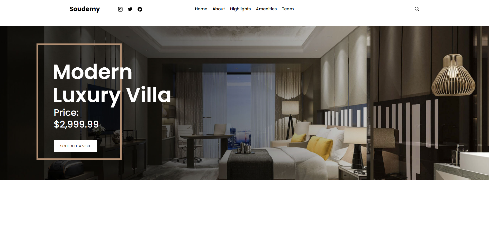

# Modern Luxury Villa

[English](README.md) | [Русский](README.ru.md)

A responsive landing page built with HTML and CSS as a college assignment during my second year of studying software development.

The website was implemented from a ready-made Figma design. My contribution was the frontend development, not the original visual design.

## Preview

## Technologies

- HTML
- CSS
- Responsive layout
- Flexbox and CSS Grid

## My Contribution

- Built the page structure using semantic HTML
- Implemented the provided Figma design with CSS
- Created responsive layouts for different screen sizes
- Styled the navigation, content sections, cards and footer

## Live Demo

[View Website](https://kuposha.github.io/modern-villa/)

## Run Locally

Download the repository and open `index.html` in your browser. No additional dependencies are required.

## Design Credits

This project was created for educational purposes using a third-party Figma design.

The original design belongs to its respective creator. My work covers the HTML/CSS implementation.

This project is not affiliated with the Soudemy brand.
