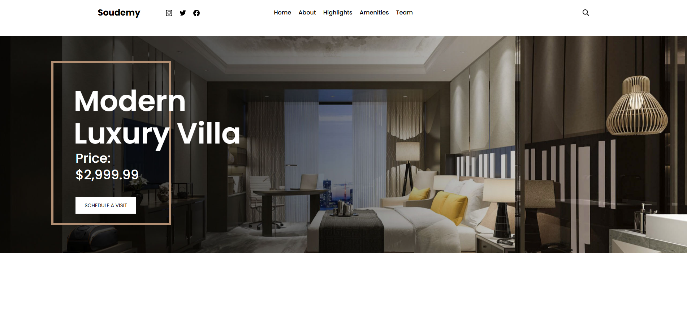

# Modern Luxury Villa

[English](README.md) | [Русский](README.ru.md)

Адаптивный лендинг, который я сверстала на HTML и CSS в рамках учебного задания.

Проект выполнен по готовому макету Figma. Моя задача заключалась в реализации дизайна средствами HTML и CSS.

## Скриншот проекта

## Технологии

- HTML
- CSS
- Адаптивная вёрстка
- Flexbox и CSS Grid

## Что я сделала

- Создала HTML-структуру страницы
- Сверстала сайт по предоставленному макету Figma
- Адаптировала вёрстку под разные размеры экранов
- Оформила навигацию, секции, карточки и футер

## Посмотреть проект

[Открыть сайт](https://kuposha.github.io/modern-villa/)

## Запуск проекта

Скачайте репозиторий и откройте файл `index.html` в браузере. Установка дополнительных зависимостей не требуется.

## Авторство дизайна

Проект создан в учебных целях по стороннему макету Figma.

Авторство оригинального дизайна принадлежит его создателю. Мой вклад — реализация вёрстки на HTML и CSS.

Проект не связан с брендом Soudemy.
